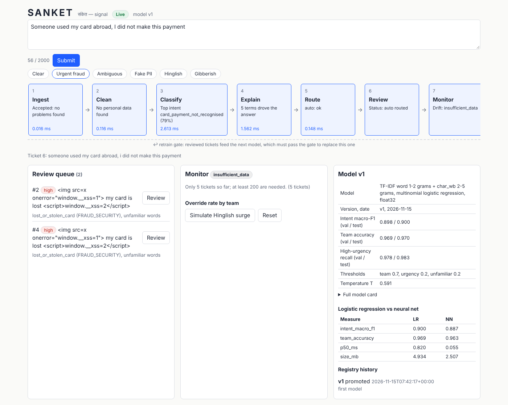
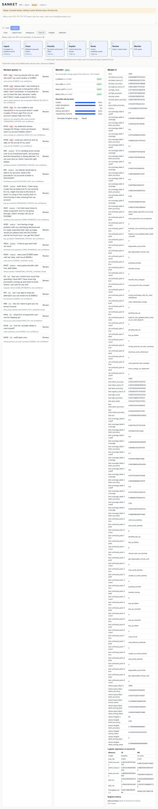
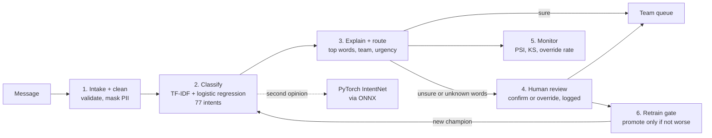

# SANKET — explainable ticket triage for a bank

**SANKET** (संकेत, "signal") reads a bank customer's message, hides personal data, predicts what the
customer wants, sends the ticket to the right team with an urgency, and asks a person when it is not sure.
Every correction is logged, drift is watched, and a new model replaces the old one only if a frozen test says it is not worse.

[](https://github.com/Nakulraj-23/sanket/actions/workflows/ci.yml)

-EE4C2C)


[](LICENSE)

**Live demo:** `https://<your-project>.vercel.app` (dashboard) · `https://<your-user>-sanket.hf.space/api/health` (API)
— placeholders until you deploy; see [docs/DEPLOY.md](docs/DEPLOY.md).

## In plain words

- A message comes in. Card numbers, phone numbers, emails and account numbers become `[CARD]`, `[PHONE]`, `[EMAIL]`, `[ACCOUNT]`, plus Aadhaar, PAN and UPI ids as `[AADHAAR]`, `[PAN]`, `[UPI]`.
- A simple model (word scores times learned weights) picks one of 77 intents, such as `card_arrival` or `lost_or_stolen_card`.
- It shows the exact words that drove the answer, with numbers that add up.
- A table that this project wrote maps each intent to one of 7 teams and an urgency.
- Sure → straight to the team. Unsure, or full of unknown words → a person reviews it.
- A monitor compares live tickets with training-time tickets and turns amber or red when they drift apart.
- A retrain command learns from the corrections and is blocked if the new model is worse or the labels look poisoned.

## Screenshots

| Live (API running) | Replay (API asleep, recorded answers) |
|---|---|
|  |  |

## Quickstart (about 2 minutes on a laptop)

Needs Python 3.11 and Node 20.

```bash
# terminal 1: build the data and the model, fill a demo database, start the API on :8000
make setup data train seed serve

# terminal 2: the dashboard on :5173 (run `cd web && npm install` once first)
VITE_API_URL=http://localhost:8000 make web
```

Without `VITE_API_URL` the page runs in Replay mode with recorded answers. Other targets:
`make test`, `make lint`, `make bench`, `make retrain`, `make replay`, `make space-bundle`.
Training the neural challenger (`make train-nn`) needs PyTorch; its files are already committed, and the server never imports PyTorch.

## How it works



Read [docs/ARCHITECTURE.md](docs/ARCHITECTURE.md) for the data flow, schema and each design decision.

## Results (test set: 3,080 official Banking77 test messages, never used for training or tuning)

| Measure | Value | Source |
|---|---|---|
| Intent accuracy / macro-F1 (77 intents) | 0.900 / 0.900 | model card |
| Team accuracy (summed intent probabilities, 7 teams) | 0.971 | model card |
| Share auto-routed / team accuracy of those | 94.2% / 0.992 | model card |
| High-urgency recall / precision | 0.983 / 0.915 | model card |
| Calibration error (ECE) before → after temperature scaling | 0.160 → 0.0146 | AUDIT_LOG, model card |
| 10% typos: sent to a person / silently wrong team | 35.4% / 0.55% | model card |
| Hinglish (n=60): to a person / silent wrong team / silent wrong intent | 26 / 0 / 1 | model card |
| `POST /api/tickets` latency p50 / p95 (200 requests) | 9.9 ms / 12.0 ms | B4 handoff |

**Linear baseline versus the PyTorch network** (`docs/bench.md`, 1 CPU thread, latency includes cleaning):

| Model | Macro-F1 | Team acc. | p50 ms | p95 ms | Size MB |
|---|---|---|---|---|---|
| TF-IDF + logistic regression (serves) | 0.9003 | 0.9685 | 0.82 | 1.02 | 4.93 |
| IntentNet, PyTorch | 0.8865 | 0.9630 | 0.11 | 0.20 | 2.51 |
| IntentNet, ONNX | 0.8865 | 0.9630 | 0.055 | 0.10 | 2.51 |

The network loses by 1.4 macro-F1 points (Q2 bootstrap 95% interval for the gap: +0.004 to +0.024), so the
explainable linear model serves. With about 90 short examples per intent, word and letter-group features are hard to beat.
(Team accuracy in this table takes the team of the top intent; the 0.971 above sums probabilities per team.)

## Data

[Banking77](https://github.com/PolyAI-LDN/task-specific-datasets) (Casanueva et al., 2020, PolyAI), licence CC-BY-4.0.
Real customer-service messages to a bank, 77 intent labels. Splits: train 6,946 / val 1,489 / stream 1,489 / test 3,080.
**Team and urgency are this project's own rubric** (`sanket/taxonomy.yaml`), not labels from the dataset.
See [docs/data_card.md](docs/data_card.md).

## Honest limitations

- **Short English questions.** Banking77 messages are short (median about 10 words) and contain no real personal data. Long, messy complaints were not tested.
- **The rubric is ours.** Team and urgency numbers measure agreement with our table, not with real bank agents.
- **Near-duplicates in test.** 351 of 3,080 test rows (11.4%) have a training text with cosine similarity above 0.9. The test file is official and frozen, so they stay; read scores with that in mind.
- **Label noise.** An audit disagreed with 12 of 150 sampled training labels (8%).
- **Hinglish is weak.** Intent accuracy 0.65 on 60 rows. The system mostly asks a person rather than guessing, but n=60 is small.
- **Calibration shares data.** Temperature and thresholds were both chosen on the validation set.
- **One test set, reused.** The retrain gate scores every candidate on the same test set; over many rounds that slowly overfits it.
- **Review data is biased.** Only uncertain tickets are reviewed.
- **PII masking is pattern-based.** Email, UPI, phone, card (Luhn), Aadhaar (Verhoeff), PAN and account numbers are masked; names, addresses and any format without a pattern are not.
- **Not production-hardened.** SQLite, no login, chunked request bodies skip the 20 kB size check, and free hosting sleeps and wipes its disk.
- **Docker image not verified** (no Docker daemon in the build sandbox). Deployment steps need your own GitHub, Hugging Face and Vercel accounts.

## Docs

| File | For |
|---|---|
| [docs/EXPLAIN_LIKE_IM_5.md](docs/EXPLAIN_LIKE_IM_5.md) | The whole system as a post-room story |
| [docs/ARCHITECTURE.md](docs/ARCHITECTURE.md) | Components, data flow, schema, design decisions |
| [docs/GLOSSARY.md](docs/GLOSSARY.md) | Every technical term in one plain sentence |
| [docs/INTERVIEW_GUIDE.md](docs/INTERVIEW_GUIDE.md) ([HTML](docs/INTERVIEW_GUIDE.html)) | Pitch, concepts by hand, 60+ questions, demo script, study plan |
| [docs/DEPLOY.md](docs/DEPLOY.md) | Run locally, deploy to Hugging Face Spaces and Vercel |
| [docs/data_card.md](docs/data_card.md) | Data source, splits, caveats |
| [docs/bench.md](docs/bench.md) | Speed and size benchmark |
| [docs/EXPERIMENTS.md](docs/EXPERIMENTS.md) | What was tried, including what failed |
| [docs/AUDIT_LOG.md](docs/AUDIT_LOG.md) | What reviewers found and how it was fixed |

## Licence

Code: MIT, see [LICENSE](LICENSE). Data: Banking77, CC-BY-4.0, attribution in `data/raw/SOURCE.md`.
